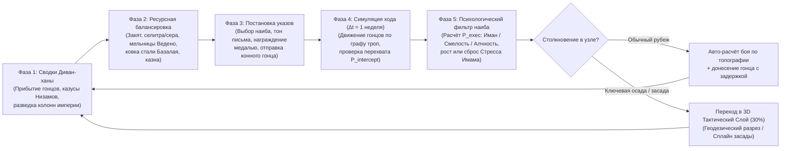
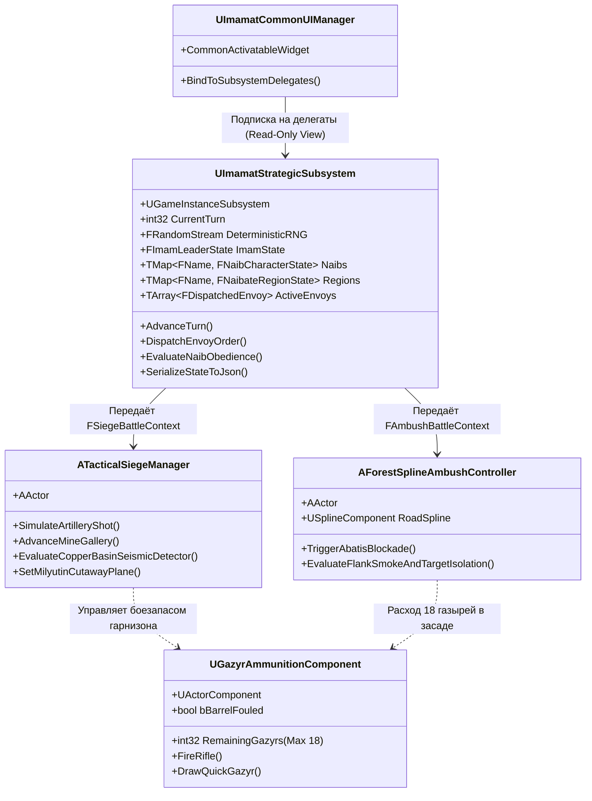

# ARCHITECTURE & PRODUCTION BLUEPRINT: «ИМАМАТ: ДИВАН-ХАНА (1834–1859)»

* **Документ:** Master Production & Technical Architecture Blueprint (v1.0)
* **Поджанр:** Асимметричная Гранд-стратегия и симулятор непрямого управления (70%) + Безсеточный топографический тактический варгейм (30%)
* **Целевая платформа:** PC (Steam: Windows DX12 / macOS Metal)
* **Движок и стек:** Unreal Engine 5.5 (C++20 Core Simulation, MassEntity / Data-Oriented Subsystems, CommonUI/UMG, HLSL Custom Cutaway Shaders, Python SRTM Pipeline) + Веб-прототип (`React/Vite`) как живая математическая песочница баланса
* **Команда и ресурсы:** 1–2 разработчика + AI-пайплайн 2026, бюджет \$15,000–\$30,000
* **Таймлайн:** Vertical Slice — 16 недель (4 мес.); Steam Early Access — 40–48 недель (10–12 мес.)
* **Режим игры:** 100% Singleplayer (детерминированное ядро симуляции на фиксированном `Seed` для реплеев, сохранений и отладки баланса)

---

## 0. Продюсерский аудит скоупа (Scope Creep Alert & Reality Check)

При команде из **1–2 человек**, бюджете **\$15k–\$30k** и сроке **3–4 месяца до Vertical Slice** на **Unreal Engine 5.5** главная угроза смерти проекта — попытка сделать «кавказский *Total War* с фотореалистичной пехотой вблизи».

### Что МЫ РЕЖЕМ (Hard Scope Cuts для v1.0):
1. **Никаких тысяч скелетных мешей (Skeletal Meshes) с лицевой анимацией и рукопашным mocap-боем в тактике.** На создание, ретаргетинг, коллизии и LOD-оптимизацию анимированных кавказских горцев и русских батальонов уйдёт \$150k+ и 2 года работы 3D-аниматоров.
2. **Решение — Диегетическая штабная 3D-диорама («Взгляд Военного Топографа XIX века»):**
   * В 30% тактического слоя реальный 3D-ландшафт (построенный по высотам NASA SRTM через [`prepare_caucasus_srtm_ue5.py`](file:///Users/alibegov/Downloads/Кавказская%20война/04_UE5_ImamatWargame/Tools/prepare_caucasus_srtm_ue5.py)) рендерится с кинематографическим освещением Lumen и шейдером разреза скалы [`MF_MilyutinCutawaySection.hlsl`](file:///Users/alibegov/Downloads/Кавказская%20война/04_UE5_ImamatWargame/Shaders/MF_MilyutinCutawaySection.hlsl).
   * Юниты и отряды в тактике представлены в виде **детализированных тактических батальонных знаков / оловянно-бронзовых штабных фигур и процедурных трассеров ядер/выстрелов/взрывов мин (Niagara VFX)** (как в *HighFleet*, *Radio Commander* или режиме тактической карты *Manor Lords* / *Ultimate General*).
   * Это сокращает стоимость 3D-арта в **12 раз**, даёт стабильные 60+ FPS на средних ПК и идеально работает на главный козырь игры — инженерную геодезию осад (мёртвые зоны мортир, подземные блиндажи Сафарова, минные галереи) и сплайновые засады.
3. **Ограничение карт для Vertical Slice и Early Access:**
   * **Vertical Slice (Месяц 4):** 1 кампания («Даргинский поход и осада Салтов, 1845–1847»), 12 ключевых наибств на стратегической карте, 8 исторических наибов, 1 тактическая горная осада (**Салты 1847**) и 1 сплайновая лесная засада (**Ичкерийский лес / «Сухарная экспедиция» 1845**).
   * **Early Access (Месяц 10–12):** Расширение до 4 кампаний (Ахульго 1839, Триумф 1843, Дарго 1845, Гуниб 1859).

---

## 1. Геймдизайн и Игровая Петля (Core, Tactical & Meta Loops)

### 1.1. Контур управления и задержки сигнала (Core Loop — 70% времени)
Игрок **не двигает полки мышкой в реальном времени**. Игрок находится в резиденции Диван-ханы (Дарго / Ведено) и управляет государством в условиях информационного вакуума (Fog of Latency):

### 1.2. Три уровня удержания (Retention Loops)
1. **Микро-цикл (5–8 минут, 1–2 игровых хода):** Принятие судебного решения по Низаму $\rightarrow$ реакция наибов и сословий $\rightarrow$ отправка гонца с порохом в осаждённый аул $\rightarrow$ ожидание: дойдёт ли караван через перевал или будет перехвачен лазутчиками М. С. Воронцова.
2. **Мезо-цикл (45–60 минут, 1 военный сезон — весна/лето или осень/зима):** Подготовка к весенней экспедиции Отдельного Кавказского корпуса (накопление селитры в Хунзахе и Ведено, строительство засек в Чечне, ротация алчных наибов) $\rightarrow$ кульминационная тактическая битва сезона (осада или лесной разгром колонны) $\rightarrow$ распределение трофеев, орденов и пленных.
3. **Макро-цикл (4–6 часов на кампанию):** Балансирование между модернизацией государства (жёсткие Низамы, подавление адатов и власти ханов/беков) и риском внутреннего раскола (переход обиженных наибов вроде Хаджи-Мурата на сторону империи) на фоне тающих ресурсов блокады и дипломатической игры со Стамбулом.

---

## 2. Математическая Модель и Инварианты Симуляции

Все правила фиксируются в детерминированном C++20 ядре ([`UImamatStrategicSubsystem`](file:///Users/alibegov/Downloads/Кавказская%20война/04_UE5_ImamatWargame/Source/ImamatWargame/Public/Strategic/ImamatStrategicSubsystem.h)) и проверяются на строгих инвариантах.

### 2.1. Инвариант №1: Время доставки и перехват гонца на графе троп
Для каждого ребра маршрута $e \in E(v_{\text{Ведено}}, v_i)$ с длиной $D_e$ (км), средним уклоном $\alpha_e$ (град.) и плотностью вражеских разъездов $r_e \in [0, 1]$:

$$T_{\text{envoy}}(i) = \sum_{e} \frac{D_e}{V_0 \cdot \exp(-k_{\text{slope}} \cdot \tan\alpha_e) \cdot M_{\text{season}} \cdot M_{\text{horse}}}$$

Вероятность выживания гонца при прохождении всех рёбер маршрута (инвариант $P_{\text{deliver}} \in [0.05, 0.99]$):

$$P_{\text{deliver}}(i) = \prod_{e} \left(1 - \text{clamp}\left(r_e \cdot (1 - S_{\text{scout}}) \cdot M_{\text{prosec}}, \, 0.01, \, 0.95\right)\right)$$

где $M_{\text{prosec}} = 1 + 0.35 \cdot L_{\text{Евдокимов}}$ — штраф от прорубленных русскими войсками просек в Чечне.

### 2.2. Инвариант №2: Матрица повиновения наиба ($P_{\text{exec}}$)
Каждый наиб $j$ характеризуется вектором скрытых и открытых параметров $\mathbf{\Theta}_j = (\text{Iman}_j, \text{Courage}_j, \text{Greed}_j, \text{Loyalty}_j, \text{Fatigue}_j) \in [0, 100]^5$.
Вероятность точного исполнения приказа типа $m$ (Штурм / Оборона / Реквизиция закята / Сдача трофеев в казну):

$$Z_{j,m} = \beta_0 + w_I^{(m)} \cdot \frac{\text{Iman}_j}{100} + w_C^{(m)} \cdot \frac{\text{Courage}_j}{100} - w_G^{(m)} \cdot \frac{\text{Greed}_j}{100} \cdot (1 - \text{Share}_j) - w_F \cdot \frac{\text{Fatigue}_j}{100} - w_S \cdot \frac{\text{Stress}_{\text{Imam}}}{100} + B_{\text{medal}}(j)$$

$$P_{\text{exec}}(j, m) = \sigma(Z_{j,m}) = \frac{1}{1 + \exp(-Z_{j,m})}$$

**Исходы броска детерминированного ГПСЧ $u \sim \text{Uniform}(0, 1)$:**
* $u \le P_{\text{exec}}$: **Полное исполнение** (приказ выполнен в срок, $+2$ к авторитету Диван-ханы).
* $P_{\text{exec}} < u \le P_{\text{exec}} + 0.5 \cdot (1 - P_{\text{exec}})$: **Искажение / саботаж** (наиб имитирует выполнение, удерживает до $\frac{\text{Greed}_j}{200}$ казны или избегает лобового боя).
* $u > P_{\text{exec}} + 0.5 \cdot (1 - P_{\text{exec}})$ и $\text{Loyalty}_j < 25$: **Открытый мятеж / тайные переговоры с русским штабом** (триггер кризиса по модели побега Хаджи-Мурата 1851 г. или сдачи аула).

### 2.3. Инвариант №3: Стресс Предводителя ($\text{Stress}_{\text{total}} \in [0, 100]$)
Интегральное давление на Шамиля вычисляется каждый ход:

$$\text{Stress}_{\text{total}}(t+1) = \text{clamp}\left(\text{Stress}_{\text{total}}(t) + \Delta S_{\text{losses}} + \Delta S_{\text{blockade}} + \Delta S_{\text{dissent}} - \Delta S_{\text{nizam\_order}} - \Delta S_{\text{victory}}, \, 0, \, 100\right)$$

* При $\text{Stress}_{\text{total}} \ge 70$: включается режим «Подозрительность Диван-ханы» (штраф $-12\%$ к $\text{Loyalty}_j$ всех амбициозных наибов, риск казни невиновного по доносу).
* При $\text{Stress}_{\text{total}} \ge 95$ на протяжении 3 ходов подряд: политический паралич Имамата (распад коалиции вольных обществ).

### 2.4. Инвариант №4: Производственная цепочка пороха и металлургии
Порох не берётся из «золота». Каждый ход $t$ выпуск боевого пороха $Q_{\text{powder}}(t)$ (в пудах) ограничен узким местом Леонтьева (минимумом из 3 компонентов и мощности водяных/конных мельниц Ведено, Гуниба и Хунзаха):

$$Q_{\text{powder}}(t) = \eta_{\text{mill}} \cdot \min\left(\frac{\text{Saltpeter}(t)}{0.75}, \, \frac{\text{Sulfur}(t)}{0.12}, \, \frac{\text{Charcoal}(t)}{0.13}, \, C_{\text{mills}}(t)\right)$$

Любой выстрел горской артиллерии в тактике потребляет $0.25$ пуда пороха, а пополнение комплекта из 18 нагрудных газырей ([`UGazyrAmmunitionComponent`](file:///Users/alibegov/Downloads/Кавказская%20война/04_UE5_ImamatWargame/Source/ImamatWargame/Public/Tactical/GazyrAmmunitionComponent.h)) на сотню мюридов — $1.1$ пуда.

### 2.5. Инвариант №5: 3D-баллистика осады и мёртвая зона скалы ([`ATacticalSiegeManager`](file:///Users/alibegov/Downloads/Кавказская%20война/04_UE5_ImamatWargame/Source/ImamatWargame/Private/Tactical/TacticalSiegeManager.cpp))
В тактическом режиме горной осады (Ахульго, Салты, Гуниб) траектория снаряда с начальной скоростью $v_0$ и углом возвышения $\theta$ в поле тяжести $g = 9.81\,\text{м/с}^2$:

$$z(d) = z_{\text{battery}} + d \cdot \tan\theta - \frac{g \cdot d^2}{2 \cdot v_0^2 \cdot \cos^2\theta}$$

Выстрел блокируется скальным гребнем (Мёртвая зона настильного огня), если в точке гребня $d_{\text{crest}}$:

$$z(d_{\text{crest}}) < z_{\text{crest}} + h_{\text{safety}}$$

Разрушение подземного бревенчатого блиндажа Сафарова глубиной залегания $H_{\text{soil}}$ и числом накатов дуба $N_{\text{logs}}$ возможно **только** навесным огнём мортир ($\theta \ge 45^\circ$) или подземным минным горном при условии:

$$E_{\text{impact}} > k_{\text{earth}} \cdot H_{\text{soil}}^2 + k_{\text{oak}} \cdot N_{\text{logs}}$$

---

## 3. Технический Стек и Архитектура Кода (Unreal Engine 5.5)

### 3.1. Разделение слоёв (Decoupled Simulation Architecture)
Чтобы избежать спагетти-кода в Blueprints и обеспечить мгновенные сохранения/реплеи, архитектура строится по принципу **Strict Model-View Separation**:

### 3.2. Ключевые инженерные решения
1. **Детерминизм (Deterministic Seed & Replayability):**
   * Ни одного вызова `FMath::Rand()` или `FMath::FRand()`! Все случайные события (погода в горах, перехват гонца, бросок повиновения наиба, разброс мортиры) идут исключительно через `FRandomStream` с фиксируемым `CampaignSeed`.
   * Это позволяет сохранять всю партию в JSON/Binary размером **менее 64 КБ** и воспроизводить любой баг баланса по логу приказов игрока.
2. **Data-Driven баланс через `UDataTable` / JSON-экспорт из веб-прототипа:**
   * Наш рабочий веб-прототип ([`03_Веб_прототип_Диван_Хана/src/App.jsx`](file:///Users/alibegov/Downloads/Кавказская%20война/03_Веб_прототип_Диван_Хана/src/App.jsx)) используется как **Rapid Balance Sandbox**: мы тестируем коэффициенты формул в браузере за секунды и экспортируем таблицы наибов, аулов и Низамов напрямую в `DT_Naibs`, `DT_Regions` и `DT_Nizams` в Unreal Engine 5.5 ([`ImamatStrategicTypes.h`](file:///Users/alibegov/Downloads/Кавказская%20война/04_UE5_ImamatWargame/Source/ImamatWargame/Public/Strategic/ImamatStrategicTypes.h)).
3. **Геодезический пайплайн реального рельефа:**
   * Скрипт [`prepare_caucasus_srtm_ue5.py`](file:///Users/alibegov/Downloads/Кавказская%20война/04_UE5_ImamatWargame/Tools/prepare_caucasus_srtm_ue5.py) конвертирует растры NASA SRTM (квадрат `42°00'–43°10' N, 46°00'–47°20' E`: Гуниб, Ахульго, Салты, Дарго) в `uint16` RAW (`2017x2017` для стратегической карты и `1009x1009` для тактических полигонов) + 4 маски слоёв (`Cliff`, `Alpine`, `Forest`, `Riverbed`).
4. **GPU-оптимизация разреза скалы (Cutaway Shader):**
   * Вместо тяжёлого Boolean Mesh-моделирования подземных блиндажей и минных галерей в реальном времени используется шейдер [`MF_MilyutinCutawaySection.hlsl`](file:///Users/alibegov/Downloads/Кавказская%20война/04_UE5_ImamatWargame/Shaders/MF_MilyutinCutawaySection.hlsl) через `Global Material Parameter Collection (MPC_SiegeCutaway)`. Стоимость на GPU — менее `0.15 ms`.

---

## 4. Производственный План (Roadmap, Майлстоуны и Зависимости)

Горизонт: **16 недель (8 двухнедельных спринтов) до полностью играбельного Vertical Slice** + **28 недель до выхода в Steam Early Access**.

| Майлстоун | Сроки | Главная цель (Deliverable) | Блокирующие зависимости (Blockers) | Критерий приёмки (Definition of Done) |
|---|---|---|---|---|
| **M1: Core Simulation & Data Bridge** | Недели 1–4 (Спринты 1–2) | Компилируемый проект UE 5.5 с модулем `ImamatWargame`, импортом `DataTable` наибов/регионов и полным циклом `AdvanceTurn()` в C++20. | Фиксация структуры `FNaibCharacterState` и `FNaibateRegionState` в [`ImamatStrategicTypes.h`](file:///Users/alibegov/Downloads/Кавказская%20война/04_UE5_ImamatWargame/Source/ImamatWargame/Public/Strategic/ImamatStrategicTypes.h). | 50 ходов кампании 1845 г. прогоняются в Headless/Debug-режиме без крашей; `FRandomStream` даёт 100% идентичный результат при одном `Seed`. |
| **M2: 3D Strategic Map & Divan-Khana UI** | Недели 5–8 (Спринты 3–4) | Импорт SRTM-ландшафта Дагестана и Чечни (`2017x2017`), сплайны горных троп, UMG-интерфейс Диван-ханы, Кодекса Низамов и отправки гонцов. | Готовность выгрузки высот из [`prepare_caucasus_srtm_ue5.py`](file:///Users/alibegov/Downloads/Кавказская%20война/04_UE5_ImamatWargame/Tools/prepare_caucasus_srtm_ue5.py) и базового UI-макета в CommonUI. | Игрок может пройти 15 ходов на стратегической карте, принимать Низамы, ковать сталь Базалая, отправлять гонцов и видеть честный расчёт $P_{\text{exec}}$. |
| **M3: Tactical Vertical Slice (Siege & Ambush)** | Недели 9–12 (Спринты 5–6) | Два тактических полигона: **Осада Салтов (1847)** с разрезом скалы [`MF_MilyutinCutawaySection.hlsl`](file:///Users/alibegov/Downloads/Кавказская%20война/04_UE5_ImamatWargame/Shaders/MF_MilyutinCutawaySection.hlsl) и **Засада в Ичкерийском лесу (1845)** ([`AForestSplineAmbushController`](file:///Users/alibegov/Downloads/Кавказская%20война/04_UE5_ImamatWargame/Source/ImamatWargame/Public/Tactical/ForestSplineAmbushController.h)). | Завершение M1 (передача пороха и 18 газырей из стратегии в тактику). | Бесшовный переход из глобальной карты в тактический бой и обратно с сохранением потерь, трофейных орудий и расхода пороха. |
| **M4: Vertical Slice Polish & Steam Page Launch** | Недели 13–16 (Спринты 7–8) | Аудио-дизайн, AI-арт портретов в стиле литографий Гагарина/Тимма, сборка закрытого плейтест-билда (45–60 мин геймплея), публикация страницы в Steam и тизера. | Стабильные 60 FPS в 1440p; закрытие критических багов M2–M3. | Готовый билд для Steam Playtest и фестиваля Steam Next Fest; страница в Steam собирает первые вишлисты. |
| **M5: Content Expansion & Early Access** | Недели 17–44 (Месяцы 5–11) | Кампании **Ахульго (1839)**, **Триумф (1843)** и **Гуниб (1859)**, полная дипломатия со Стамбулом, 25+ исторических наибов, локализация (RU/EN/TR/AR). | Плейтест-телеметрия M4 (баланс кривой сложности и стресса). | Выход в Steam Early Access. |

---

## 5. Матрица Рисков и План Минимизации (Risk Management)

| Категория | Описание риска | Вероятность / Ущерб | Стратегия минимизации (Mitigation Plan) |
|---|---|---|---|
| **Производственный (Scope Creep)** | Застревание на производстве 3D-ассетов аулов, персонажей и анимаций для тактических боёв силами 1–2 человек. | **Высокая / Критический** | Жёсткая фиксация визуального стиля **«Военно-топографическая 3D-диорама XIX века»**: реальный SRTM-рельеф + шейдер разреза скалы + стилизованные штабные батальонные знаки и Niagara-трассеры вместо скелетной массовки. |
| **Геймдизайнерский (Opaque Math)** | Игрок не понимает, почему наиб саботировал приказ или почему гонец пропал, и воспринимает честную математику как «нечестный рандом». | **Высокая / Высокий** | **Прозрачный UI предпросмотра (Forecast Breakdown):** перед отправкой гонца игрок видит декомпозицию шанса $P_{\text{exec}}$ и $P_{\text{deliver}}$ по факторам (Иман $+25\%$, Алчность $-18\%$, Снег на перевале Харигавуль $-15\%$, Медаль «За храбрость» $+10\%$). |
| **Технический (State Desync)** | Потеря состояния или баги при переходе между уровнем `StrategicMap` и уровнями `TacticalSiege` / `TacticalAmbush` в UE 5.5. | **Средняя / Высокий** | Вся память кампании живёт исключительно в `UImamatStrategicSubsystem` (наследник `UGameInstanceSubsystem`), который **не уничтожается** при смене `UWorld` (`OpenLevel`). Тактический уровень получает `FSiegeBattleContext` и возвращает `FSiegeBattleResult`. |
| **Коммерческий / Маркетинговый (Steam)** | Узкая ниша при позиционировании только как «региональная историческая игра», риск модерации или политических споров в отзывах. | **Средняя / Средний** | 1) Позиционирование на глобальную аудиторию игроков *Suzerain*, *Crusader Kings III*, *Frostpunk*, *HighFleet* («Хардкорная стратегия о выживании государства в блокаде и психологии власти»). 2) Строгий академический нейтралитет и опора на архивные источники обеих сторон (АКАК, Милютин, аль-Карахи, Доного, BOA). 3) Локализация со старта на **Русский, Английский, Турецкий и Арабский** языки (огромный неохваченный рынок MENA и Турции в Steam). |

---

## 6. Пайплайн Арта и ИИ-Ассистентов (2026 Solo/Micro-Team Pipeline)

1. **2D-Портреты, Литографии и События Диван-ханы:**
   * Единый LoRA/Style-пайплайн, обученный на общественном достоянии XIX века: акварелях кн. Г. Г. Гагарина, литографиях В. Ф. Тимма («Русский художественный листок»), зарисовках Т. Горшельта и дагерротипах 1850–1860-х гг.
   * Постобработка в единой палитре (сепия, сусальное золото, черкесское сукно, пороховой дым).
2. **3D-Окружение и Архитектура Горного Дагестана:**
   * Процедурный **PCG (Procedural Content Generation) граф в UE 5.5** для генерации террасных каменных саклей вдоль горизонталей склона ($15^\circ\text{–}38^\circ$), сторожевых башен и бревенчатых засек из 8–10 модульных мешей известняка и дуба (Quixel Megascans + кастомные ассеты).
3. **Звук и Озвучка (Audio & Diegetic Soundscape):**
   * Диегетический звук в Диван-хане: скрип тростникового калама по бумаге, шум горного ветра и реки Андийское Койсу, сургучная печать, топот копыт удаляющегося гонца, глухие удары кирок в минной галерее и звон монет на медном тазу.
