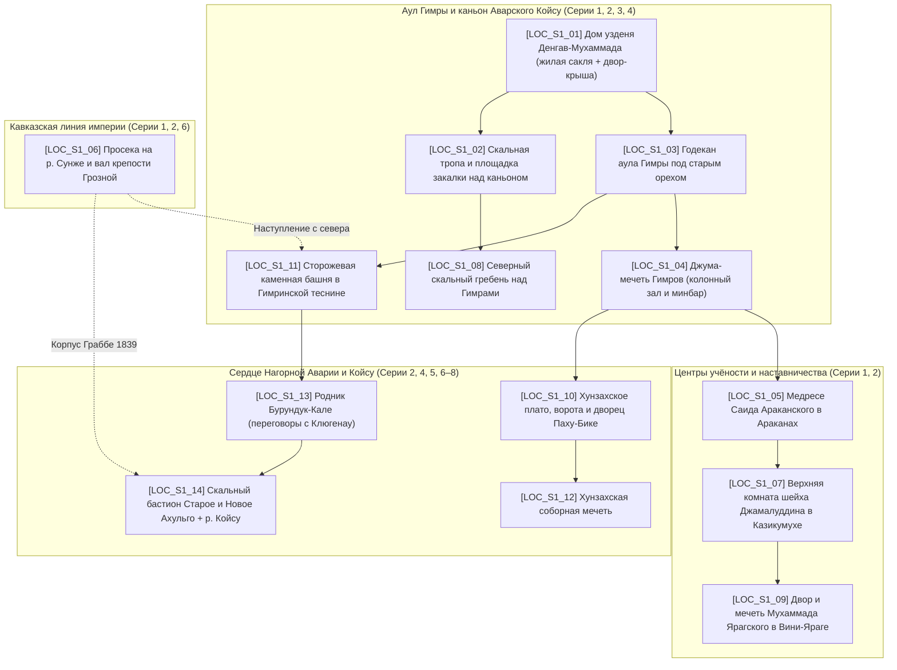

# АРХИТЕКТУРНЫЙ И ПРЕДМЕТНЫЙ ПАСПОРТ ЛОКАЦИЙ 1-ГО СЕЗОНА (`1797–1839`)
## Единый реестр пространств и реквизита (`LOCATION_CANON` & `PROP_REGISTRY`)

> **Статус документа:** Неизменяемый строительный и предметный эталон 1-го сезона («Три имама и скала Ахульго», Серии `1–8`).  
> **Визуальные референсы в пакете:** [caucasus3d_photoreal_avaria_gorges.png](./Previz_3D/caucasus3d_photoreal_avaria_gorges.png), [caucasus3d_photoreal_overview_day.png](./Previz_3D/caucasus3d_photoreal_overview_day.png), [battle3d_siege_panorama_day.png](./Previz_3D/battle3d_siege_panorama_day.png).  
> **Закон сохранения обстановки (Causal Continuity):** Любая локация при входе в сцену находится строго в зафиксированном ниже базовом состоянии (или в зафиксированном `Выходном состоянии` предыдущей сцены в этой же локации). Ни один предмет `[PROP_...]` не сдвигается, не исчезает и не меняет фактуру без прямого физического действия в кадре или задокументированного события между годами.

---

## 1. Схема пространственной связности локаций 1-го сезона

---

## 2. Пообъектные паспорта и поштучные описи предметов (`[LOC_S1_01]`–`[LOC_S1_14]`)

### `[LOC_S1_01]` Сакля Денгав-Мухаммада в Гимрах (интерьер жилой комнаты + плоский двор-крыша)
* **Серии:** Е01 (Сц. 1 — `1803`, Сц. 7 — `1822`), Е02 (Сц. 2 — `1826`).
* **Геометрия и материалы:**
  * Двухъярусный дом из тёмно-серого колотого известняка на сухой глиняной связке. Нижний ярус — хлев и клеть; верхний — жилая комната `5,5 × 4,8 м`, высота потолка `2,45 м`.
  * **Потолок и опора:** закопчённые сосновые балки, по центру комнаты — массивный четырёхгранный **резной опорный столб (*мугъ*)** с солярной розеткой на подбалочнике (главный визуальный якорь комнаты).
  * **Стены и проёмы:** входная одностворчатая дубовая дверь — на **южной** стене (выходит на плоский глинобитный двор — крышу нижнего яруса, огороженную низким каменным парапетом с видом на фруктовые террасы Гимров). На **восточной** стене — узкое световое оконце `45 × 60 см` с деревянным ставнем. На **северной** стене — пристенный каменный очаг (*товхане*) с расширяющимся дымарем и тремя прямоугольными стенными нишами (*рукъ*) справа от него. Пол — плотно утрамбованная серо-жёлтая глина.
* **Поштучный реестр предметов (`PROP_REGISTRY: LOC_S1_01`):**
  * `[PROP_01_01]` **Войлочный тюфяк и пёстрое аварское шерстяное одеяло (*ругъун*)** — у западной стены на деревянном низком настиле (`20 см` от пола).
  * `[PROP_01_02]` **Каменный очаг (*товхане*) с железным треножником и чугунным котлом** — центр северной стены; рядом слева лежат железные щипцы для углей и горка сухого кизяка.
  * `[PROP_01_03]` **Масляная глиняная плошка (*чираг*) с плетёным фитилём** — стоит на каменном выступе очага справа на высоте `1,1 м`.
  * `[PROP_01_04]` **Лужёный медный кувшин с узким горлом (*гунгъа*, гоцатлинской чеканки) и глиняная пиала** — в Е01 Сц. 1 стоят у изголовья тюфяка `[PROP_01_01]` вместе со свёрнутым льняным платком для компрессов; в мирное время (Е01 Сц. 7, Е02) кувшин стоит в нижней правой нише северной стены.
  * `[PROP_01_05]` **Вязанка сушёного чабреца и зверобоя** — подвешена на деревянном колышке на левой грани центрального столба *мугъ*.
  * `[PROP_01_06]` **Деревянный ларь для муки (*цагъур*) с геометрической резьбой** — в северо-восточном углу под оконцем.
  * `[PROP_01_07]` **Настенный безворсовый ковёр (*давагин*)** — висит на западной стене над настилом; поверх него на деревянном крюке — старое кремнёвое ружьё Денгав-Мухаммада в войлочном чехле (не снимается в Е01).
  * `[PROP_01_08]` **Низкая трёхногая деревянная скамья и водоносный медный кувшин (*кумухский водонос*)** — снаружи, у правого косяка южной двери на глинобитном дворе-крыше (Е01 Сц. 7).

---

### `[LOC_S1_02]` Каменистая тропа и площадка закалки над Гимринским каньоном
* **Серии:** Е01 (Сц. 2 — `1811`).
* **Геометрия и стороны света:** узкая карнизная тропа шириной `1,6–2,2 м` вдоль известнякового обрыва на западном склоне над рекой Аварское Койсу (`400 м` внизу в утреннем тумане). На расширении тропы (`6 × 4 м`) — ровная каменистая площадка для прыжков. Рассветное солнце бьёт с востока из-за противоположного гребня.
* **Поштучный реестр предметов (`PROP_REGISTRY: LOC_S1_02`):**
  * `[PROP_02_01]` **Обломок серого слоистого сланца (`70 см` высотой)** — у внутренней скальной стены на повороте тропы (постоянное сиденье Гази-Мухаммада).
  * `[PROP_02_02]` **Два вбитых в каменистый грунт кизиловых кола (`высота 1,15 м`, дистанция `2,1 м`) с туго натянутым между ними сыромятным ремнём на высоте `1,05 м`** — в центре площадки.
  * `[PROP_02_03]` **Плоский серый речной валун весом `~28 кг` со светлой кварцевой прожилкой** — в начале Сц. 2 лежит на плечах Шамиля, после пробежки сбрасывается у южного края площадки в `40 см` от обрыва (остаётся лежать там до конца сцены, вдавив мокрый гравий).
  * `[PROP_02_04]` **Рукописная тетрадь Гази-Мухаммада в мягкой коричневой коже (`18 × 12 см`)** — на коленях Гази-Мухаммада в начале Сц. 2, затем убирается в наплечную сумку.

---

### `[LOC_S1_03]` Годекан аула Гимры
* **Серии:** Е01 (Сц. 3 — `1811`), Е02 (Сц. 5 — `1829`, сбор общества).
* **Геометрия и материалы:** мощённая плоским плитняком полукруглая сельская площадь `14 × 10 м` на пересечении трёх ярусных улочек. В центре северного края — старый развесистый грецкий орех с вросшими в корни каменными скамьями старейшин (`высота 45 см`, отполированы десятилетиями сидения). Слева (запад) — каменная лестница в `7 ступеней`, ведущая к кварталу мечети.
* **Поштучный реестр предметов (`PROP_REGISTRY: LOC_S1_03`):**
  * `[PROP_03_01]` **Кизиловый суковатый посох Старейшины с железным наконечником** — в правой руке Старейшины у центральной каменной скамьи под орехом.
  * `[PROP_03_02]` **Большой пузатый глиняный кувшин с бузой (`объём ~4 л`, тёмно-терракотовая обливная шейка) и две деревянные чашки** — в Е01 Сц. 3 стоит на 2-й снизу ступеньке западной каменной лестницы. *(В Е02 Сц. 5, после утверждения шариата в Гимрах, эта ступенька демонстративно пуста — кувшинов с бузой на годекане больше нет).*

---

### `[LOC_S1_04]` Джума-мечеть в Гимрах
* **Серии:** Е01 (Сц. 6 — `ок. 1822`), Е02 (Сц. 6 — `конец 1829`, провозглашение Гази-Мухаммада первым имамом).
* **Геометрия и материалы:** прямоугольный каменный молитвенный зал `12 × 9 м` с двумя рядами из **четырёх деревянных резных колонн** по оси восток–запад. Южная стена (*кибла*) имеет полукруглую оштукатуренную белой глиной нишу **михраба**; справа от михраба — деревянный **минбар в `4 ступени`** из потемневшего ореха без росписи. На южной стене — два высоких арочных окна, дающих косые столбы дневного света сквозь пылинки. Пол сплошь устлан домоткаными шерстяными паласами в чёрно-красно-белую полосу.
* **Поштучный реестр предметов (`PROP_REGISTRY: LOC_S1_04`):**
  * `[PROP_04_01]` **Деревянный минбар на 4 ступени** — справа от михраба у южной стены.
  * `[PROP_04_02]` **Деревянная складная подставка для Корана (*ляух / рахль*) с рукописным Кораном в тиснёном кожаном переплёте** — стоит в нише михраба.
  * `[PROP_04_03]` **Посох хатыба (прямой ореховый жезл высотой `1,4 м`)** — прислонён к правой боковине минбара; проповедник берёт его в правую руку при подъёме на 3-ю ступень.

---

### `[LOC_S1_05]` Медресе Саида Араканского в ауле Араканы
* **Серии:** Е01 (Сц. 4 — `ок. 1816`), Е02 (Сц. 3 — `1827`, спор об отказе Саида поддержать выступление).
* **Геометрия и материалы:** замкнутый мощёный внутренний дворик `9 × 7 м`. По диагонали с северо-запада на юго-восток выложен узкий каменный желоб **арыка (`ширина 30 см`)** с проточной горной водой. С северной стороны — открытый деревянный навес (**айван**) на трёх точёных столбах, приподнятый на `35 см` над двором и застланный войлочными коврами *арбабаш*. За айваном — дверь в книгохранилище Саида Араканского (через проём видны полки от пола до потолка с сотнями горизонтально сложенных арабских томов).
* **Поштучный реестр предметов (`PROP_REGISTRY: LOC_S1_05`):**
  * `[PROP_05_01]` **Низкий ореховый столик учителя (`60 × 40 × 28 см`)** — у центрального столба айвана; на нём: бронзовая чернильница, перочинный ножик для заточки каламов, песочница для просушки чернил и раскрытый том по шафиитскому праву (*«Минхадж ат-талибин»*).
  * `[PROP_05_02]` **Учебные листы плотной тряпичной бумаги и деревянные дощечки (*лух*) с тростниковыми каламами** — перед каждым из 7 муталимов, сидящих полукругом на айване.
  * `[PROP_05_03]` **Узелок из небелёного холста с сушёным араканским инжиром** — в кармане бешмета Гази-Мухаммада в Сц. 4, разворачивается на каменном бортике арыка во второй половине сцены.

---

### `[LOC_S1_06]` Просека на реке Сунже и строящийся вал крепости Грозной
* **Серии:** Е01 (Сц. 5 — `1818`), Е02 (Сц. 1 — `1825`, завершённый бастион и орудийная платформа).
* **Геометрия и эволюция локации между Е01 и Е02 (строго по времени строительства):**
  * **В Е01 (1818):** свежая просека шириной `300 шагов` (расстояние ружейного выстрела по приказу Ермолова) сквозь буковый лес вдоль левого берега мутной Сунжи. Сотни свежеспиленных светлых пней, поваленные стволы, дым костров из сучьев; на заднем плане справа (юго-запад) солдаты в серых шинелях насыпают тачками сырой глиняный бруствер и вкапывают дубовый палисад.
  * **В Е02 (1825 — прямое следствие работ Е01):** пни потемнели и поросли жёсткой травой, земляной вал крепости Грозной полностью задернован, над рвом поднят бревенчатый блокгауз и на угловом барбете стоят два медных `6-фунтовых` единорога дулами на юг — к синей гряде Чёрных гор.
* **Поштучный реестр предметов (`PROP_REGISTRY: LOC_S1_06`):**
  * `[PROP_06_01]` **Походный складной стол/планшет адъютанта с рукописной картой Сунженской линии** — в Е01 Сц. 5 у стремени гнедого коня Ермолова на пригорке; красным карандашом проведена черта у брода Ханкальского ущелья.
  * `[PROP_06_02]` **Полковой барабан Апшеронского/Куринского пехотного полка с латунным корпусом** — у строя пехоты (Е02 Сц. 1).

---

### `[LOC_S1_07]` Верхняя комната шейха Джамалуддина в Казикумухе
* **Серии:** Е01 (Сц. 8 — `1823`), Е02 (Сц. 4 — `1828`, благословение на брак Шамиля и спор о границах дозволенного).
* **Геометрия и материалы:** строгая побеленная известковым раствором угловая комната верхнего этажа `4,2 × 3,8 м` в высокогорном лакском доме. Глубокая оконная амбразура (`толщина каменной стены 75 см`) выходит на **запад** — за решётчатым деревянным переплётом без стекла слышен гул высокогорного ветра. Пол устлан тёмно-синим безворсовым паласом. Никакого оружия на стенах.
* **Поштучный реестр предметов (`PROP_REGISTRY: LOC_S1_07`):**
  * `[PROP_07_01]` **Низкий восьмигранный деревянный столик (`высота 25 см`)** — в центре комнаты.
  * `[PROP_07_02]` **Кованый медный подсвечник с одной восковой свечой** — стоит строго в центре столика `[PROP_07_01]` (в Е01 Сц. 8 свеча выгорела на треть, по левой грани подсвечника застыл один потёк воска).
  * `[PROP_07_03]` **Закрытый рукописный том Корана в тёмно-коричневом переплёте с клапаном (*лисан*)** — лежит на столике справа от подсвечника, корешком на восток.
  * `[PROP_07_04]` **Оливковые чётки на 99 зёрен** — в левой руке шейха Джамалуддина.

---

### `[LOC_S1_08]` Скальный гребень над Гимринским ущельем
* **Серии:** Е01 (Сц. 9 — `1823`), Е02 (Сц. 9 — `1830`, сигнальные костры).
* **Геометрия:** выступающий известняковый мыс (`5 × 3 м`) на высоте `900 м` над каньоном. На юге внизу — террасы Гимров; прямо на **севере** за предгорьями Салатавии просматривается плоская сизая дымка Кумыкской и Чеченской равнин.

---

### `[LOC_S1_09]` Двор и мечеть Мухаммада Ярагского в ауле Вини-Яраг (Кюра) *(вводится в Серии 2)*
* **Серии:** Е02 (Сц. 1, Сц. 4 — `1824–1829`).
* **Геометрия и материалы:** южнодагестанская архитектура из тёплого желтовато-песчаного тёсаного камня (резкий цветовой контраст с холодным серым известняком Аварии). Крытая деревянная галерея второго этажа с резными арками и винтовой балясиной; во дворе — каменный бассейн для омовения (*хауз*) с двумя медными кувшинами *афтафа*.
* **Поштучный реестр предметов (`PROP_REGISTRY: LOC_S1_09`):**
  * `[PROP_09_01]` **Белая овчина (*намазлык*) Мухаммада Ярагского** — расстелена у центрального столба галереи.
  * `[PROP_09_02]` **Свиток с арабским посланием к обществам Нагорного Дагестана, скреплённый овальной чернильной печатью Ярагского** — пишется и сворачивается на глазах зрителя в Е02.

---

### `[LOC_S1_10]` Хунзахское плато, полевой шатёр Гамзат-бека и каменный дворец Паху-Бике *(Серии 2 и 4)*
* **Серии:** Е02 (Сц. 7 — `февраль 1830`), Е04 (Сц. 1, Сц. 3–4 — `август 1834`, расправа Гамзат-бека над аварским ханским домом).
* **Геометрия и материалы:** суровое безлесое плато на высоте `2000 м`, рассечённое каньоном водопада Тобот (`глубина 90 м`). На краю обрыва — трёхэтажный замок нуцалов из тёсаного серого камня с квадратной башней, внутренним мощёным двором (`18 × 14 м`) и плоским зубчатым парапетом крыши. В августе 1834 г. в двух верстах от замка у ручья Тобот разбит большой круглый походный шатёр Гамзат-бека (`[LOC_S1_10B]`, диаметр `6 м`, зелёное плотное полотно на центральном шесте, пол устлан табасаранскими коврами).
* **Поштучный реестр предметов (`PROP_REGISTRY: LOC_S1_10`):**
  * `[PROP_10_01]` **Родовое ханское знамя Хунзаха (алое шёлковое полотнище на древке с медным навершием)** — в Е02 и начале Е04 стоит в железном кольце зубца центральной башни; после захвата замка Гамзат-беком в Е04 Сц. 4 сорвано с кольца и заменено чёрно-белым знаменем второго имама.
  * `[PROP_10_02]` **Старинная шашка покойного Султан-Ахмед-хана в ножнах синего бархата с золотой насечкой** — в Е04 Сц. 4 лежит у ног пленной Паху-Бике во внутреннем дворе замка, затем забирается в казну Гамзат-бека.
  * `[PROP_10_03]` **Посох/трость с потайным стилетом и серебряный кофейник на медном подносе** — в центре шатра Гамзат-бека `[LOC_S1_10B]` (опрокидывается на табасаранский ковёр в первые секунды резни молодых ханов в Е04 Сц. 1).
  * `[PROP_10_04]` **Золочёная ханская шашка Абу-Нуцал-хана** — оружие, которым смертельно раненный 22-летний хан отчаянно рубится внутри шатра `[LOC_S1_10B]`, рассекая полотнище задней стенки шатра и укладывая нескольких мюридов перед собственной гибелью.

---

### `[LOC_S1_11]` Каменная башня в Гимринской теснине *(Серия 3 — 17 [29] октября 1832 г.)*
* **Геометрия и материалы:** двухъярусная квадратная сторожевая постройка садовников (`4,5 × 4,5 м`, высота `6,0 м`) из серого колотого известняка на узкой скальной седловине у южного входа в сады Гимров.
  * **Проёмы и уровни:** единственная низкая дубовая дверь верхнего яруса (`1,35 × 0,75 м`) смотрит на **восток** — на узкую скальную площадку шириной в `4 шага` (`3,2 м`), обрывающуюся с юга низким садовым парапетом (`высота 0,8 м`) в крутой заросший кизилом овраг. По северной, западной и южной стенам — по две узкие щелевые бойницы (`12 × 55 см`). Между 1-м и 2-м ярусом — приставная деревянная лестница-бревно с зарубками; кровля плоская из утрамбованной глины по настилу из берёзовых и ореховых жердей.
* **Поштучный реестр предметов (`PROP_REGISTRY: LOC_S1_11`):**
  * `[PROP_11_01]` **Приставное бревно-лестница на 6 зарубок** — внутри башни у западной стены (опрокидывается при обвале части потолка во время артобстрела).
  * `[PROP_11_02]` **Два кожаных бурдюка с водой и общий кожаный мешок с порохом** — в северо-западном углу верхнего яруса (к полудню боя оба бурдюка пусты, порох на исходе — остаётся по 1–2 заряда в газырях).
  * `[PROP_11_03]` **Два горных медных единорога отряда Вельяминова** — выкачены сапёрами на соседний скальный уступ в `65 шагах` к северо-востоку от двери башни (бьют прямой наводкой по восточному углу кладки, выбивая пролом над притолокой).
  * `[PROP_11_04]` **Зажжённые смоляные фашины и ручные гранаты русских сапёров** — сбрасываются сверху через прорубленную кирками дыру (`60 × 70 см`) в плоской глинобитной кровле.
  * `[PROP_11_05]` **Пехотное кремнёвое ружьё образца 1828 г. с трёхгранным штыком гренадера Эриванского/Тифлисского полка** — оружие четвёртого солдата у порога башни, чей штык пробивает правую сторону груди Шамиля и перехватывается его правой рукой за ствол.
  * `[PROP_11_06]` **Складной походный парусиновый стул генерала А. А. Вельяминова** — поставлен на мокром камне командного пригорка в `200 шагах` выше теснины.

---

### `[LOC_S1_12]` Хунзахская соборная мечеть *(Серия 4 — пятница 19 сентября [1 октября] 1834 г.)*
* **Геометрия и материалы:** просторный сумрачный молитвенный зал `16 × 12 м` из тёмно-серого тёсаного хунзахского камня с двумя рядами из **шести массивных восьмигранных каменных столбов**, поддерживающих плоское балочное перекрытие. Вход с севера через тяжёлые двустворчатые дубовые двери (снаружи перед порогом — крытый каменный притвор, где телохранители Гамзат-бека заставляют всех входящих хунзахцев снимать и складывать войлочные бурки). Южная стена — глубокий каменный михраб и деревянный минбар на `5 ступеней`; узкие световые окна высоко под потолком дают резкие косые лучи сквозь сизый воздух.
* **Поштучный реестр предметов (`PROP_REGISTRY: LOC_S1_12`):**
  * `[PROP_12_01]` **Гора сложенных чёрных и белых войлочных бурок в северном притворе у входа** — отобраны мюридами стражи по приказу Гамзат-бека, чтобы никто не пронёс ружьё под буркой.
  * `[PROP_12_02]` **Молитвенный коврик (*намазлык*) второго имама из алого ширазского сукна** — расстелен в первом ряду справа перед михрабом.
  * `[PROP_12_03]` **Скрытый под левым отворотом черкески `[WARD_OSMAN_01]` кремнёвый пистолет Османа Хунзахского на сыромятном шнуре** — оружие первого смертельного выстрела в грудь Гамзат-бека.
  * `[PROP_12_04]` **Широкие хунзахские кинжалы (*кама*) Османа и 18-летнего Хаджи-Мурата** — в ножнах на поясе (кинжалы в мечети при Гамзат-беке не отбирались — запрет касался только бурок и ружей).

### `[LOC_S1_13]` Родник Бурундук-Кале *(Серия 5 — 18 [30] сентября 1837 г.)*
* **Геометрия и стороны света:** нейтральная каменистая лощина (`45 × 30 м`) среди скалистых безлесых гребней между Темир-Хан-Шурой и Эрпели. С западной стены известняка бьёт холодный родник в выдолбленное каменное корыто. Северный пригорок в `80 шагах` занимает спешенный полуэскадрон конвоя генерала Клюгенау; южные скальные уступы в `80 шагах` — `200` отборных мюридов Шамиля с винтовками на сошках.
* **Поштучный реестр предметов (`PROP_REGISTRY: LOC_S1_13`):**
  * `[PROP_13_01]` **Три чёрные войлочные бурки** — расстелены треугольником на ровной травянистой площадке ровно посередине лощины в `10 шагах` от каменного корыта родника (северная — под Клюгенау, южная — под Шамилем, боковая — под переводчиком).
  * `[PROP_13_02]` **Суковатая кизиловая палка-трость генерала Ф. К. Клюки фон Клюгенау** — в правой руке хромающего от старых ран генерала (в финале переговоров заносится им для удара над головой Али-бека).
  * `[PROP_13_03]` **Широкий хунзахский кинжал Али-бека (Сурхая)** — выхватывается на треть из ножен в момент попытки Клюгенау пожать руку Шамилю и перехватывается левой кистью самого Шамиля.

### `[LOC_S1_14]` Скальный бастион Старое и Новое Ахульго *(Серии 6–8 — 12 июня — 22 августа 1839 г.)*
* **Геометрия и 5 пространственных подзон (строго по топографическому плану капитана Д. А. Милютина):**
  * **`[LOC_S1_14A]` Сурхаева башня (*Кала-Сурхай*):** круглая двухъярусная твердыня из циклопических необработанных валунов и брёвен на острой южной вершине (`300 м` выше плато Ахульго), окружённая кольцом каменных завалов. Внутри и на бруствере уложены штабеля откатных каменных глыб и брёвен. *(В Е06 Сц. 8 отбивает первый штурм 29 июня; **в Е07 4 июля разрушается до основания перекрёстным огнём батарей Граббе — после Е07 Сц. 2 на этой вершине во всех кадрах остаётся только дымящийся щебень и установленные там русские горные орудия!**)*
  * **`[LOC_S1_14B]` Новое Ахульго и семейный каземат Шамиля:** восточный отвесный утёс (`180–200 м` над водой); сакли наполовину вырублены в известняке и перекрыты накатником из брёвен и земли, соединённые узкими крытыми траншеями.
  * **`[LOC_S1_14C]` Навесной дощатый мост над расселиной р. Ашильты:** консольный деревянный настил из сосновых плах (`ширина 1,2 м`, без перил!) над 40-метровой трещиной между Старым и Новым Ахульго.
  * **`[LOC_S1_14D]` Старое Ахульго и западный обрыв к воде:** более широкий северо-западный утёс; вдоль его западного обрыва инженер-капитан Шульц к началу августа пробивает крытую бревенчатую сапёрную галерею к реке, отрезая горцев от ночного водопоя.
  * **`[LOC_S1_14E]` Три прибрежные пещеры над самой пеной Андийского Койсу и штабная высота Граббе на Ашильтинском гребне:** гроты в подножии утёса у воды (место спуска за водой и ночного прорыва 21–23 августа в Е08) и командный редут Граббе с `26 орудиями` на юге.
* **Поштучный реестр предметов (`PROP_REGISTRY: LOC_S1_14`):**
  * `[PROP_14_01]` **Штабеля заготовленных валунов и дубовых кряжей с деревянными рычагами-вагами** — на внешнем кольце Сурхаевой башни `[LOC_S1_14A]` (сбрасываются вниз при штурме 29 июня в Е06).
  * `[PROP_14_02]` **Полевой кожаный планшет, медная буссоль и карандашные кроки скалы Ахульго 23-летнего капитана Генштаба Д. А. Милютина** — создаются на глазах зрителя в Е06 (в Е07 на листе кроков остаётся бурая капля крови раненого в правое плечо Милютина!).
  * `[PROP_14_03]` **Латунная раздвижная подзорная труба генерала П. Х. Граббе на треноге** — на бруствере штабной батареи.
  * `[PROP_14_04]` **Верёвочная лебёдка из связанных сыромятных ремней и два медных водоносных кувшина** — у тайного ночного спуска женщин с Нового Ахульго к реке Койсу (в Е07 один из кувшинов пробивается картечью при освещении берега светящимися ракетами).
  * `[PROP_14_05]` **Учебная деревянная дощечка (*лух*) 8-летнего Джемалуддина из Чиркаты (`[PROP_20_02]`)** — стоит в углу подземного семейного каземата на Новом Ахульго `[LOC_S1_14B]` (остаётся брошенной в разрушенном каземате после увода мальчика в аманаты в Е07!).
  * `[PROP_14_06]` **Парадная чистая белая детская черкеска 8-летнего Джемалуддина** — бережно хранится в узелке Патимат/Джаварат и надевается на мальчика отцом утром 13 августа 1839 г. перед выдачей в русский лагерь (Е07).
  * `[PROP_14_07]` **Ложный бревенчатый плот с тремя чучелами из соломы в бурках и папахах** — вяжется мюридами ночью в прибрежной пещере `[LOC_S1_14E]` и спускается по течению Койсу для отвлечения огня русских пикетов (Е08).
  * `[PROP_14_08]` **Пороховые минные галереи русских сапёров под карнизом Старого Ахульго** — закладываются 17–19 августа, подрывая скальный склон перед захватом Старого утёса (Е08).
  * `[PROP_14_09]` **Перекидной мостик из двух обтёсанных брёвен над узкой каменной горловиной Койсу** — ночной путь прорыва восьмёрки Шамиля после стычки с русским пикетом в кустах, сбрасывается ими в воду за собой (Е08).

---

### `[LOC_S1_15]` Уступы аула Тарки под стенами крепости Бурной *(Серия 3 — май 1831 г.)*
* **Геометрия:** крутой восточный склон горы **Тарки-Тау** с видом на серо-зелёное зеркало Каспийского моря внизу на востоке. На плоской вершине над ярусными саклями шамхальской столицы Тарки нависает каменный бастион русской крепости **Бурная**; у подножия северного бастиона — сводчатый каменный пороховой погреб (подрывается в ходе штурма в Е03 Сц. 2, оставляя воронку и обрушенный угол контрэскарпа).

---

### `[LOC_S1_16]` Тайная верхняя комната хирурга Абдул-Азиза в ауле Унцукуль *(Серия 3 — октябрь 1832 — весна 1833 г.)*
* **Геометрия и материалы:** изолированная внутренняя клеть-комната `4,6 × 3,6 м` без наружных уличных окон (свет падает только через узкий световой люк `35 × 35 см` в потолке и масляный светильник, чтобы ни один лазутчик в ауле не увидел раненого Шамиля). Стены из тёмного речного булыжника и глины; вдоль северной стены — деревянные полки лекаря с глиняными горшочками мазей, связками сухих кореньев и костоправными лубками.
* **Поштучный реестр предметов (`PROP_REGISTRY: LOC_S1_16`):**
  * `[PROP_16_01]` **Широкий деревянный топчан на четырёх коротких ножках, застланный чистой белой овчиной** — вдоль западной стены.
  * `[PROP_16_02]` **Медный ковшик с кипящей смесью топлёного коровьего масла, жёлтого пчелиного воска и сосновой смолы** — на жаровне с древесным углём у центра комнаты.
  * `[PROP_16_03]` **Хирургический набор Абдул-Азиза на белом льняном полотенце:** тонкий железный зонд, кривая игла с конским волосом, узкий нож-ланцет и чистые полосы кипячёного холста для тампонов — на табурете справа от топчана.
  * `[PROP_16_04]` **Разрезанная по правому плечевому шву тёмно-бурая черкеска Шамиля `[WARD_SHAMIL_04]`** с трёхугольной сквозной пробоиной от штыка на правой груди и у лопатки, заскорузлая от запекшейся чёрно-бурой крови — сложена на деревянном сундуке в юго-западном углу (сохраняется как безмолвный вещественный свидетель чуда в Гимрах).
  * `[PROP_16_05]` **Шашка Шамиля со зазубриной на нижней трети лезвия (от удара о ружейный ствол солдата у башни)** — стоит в ножнах у изголовья топчана слева под его левую руку *(к началу Е04 кузнец в Унцукуле стачивает зазубрину, оставляя на нижней трети клинка заметную полого-вогнутую выемку стали)*.
  * `[PROP_16_06]` **Короткая ременная плеть для шариатских взысканий (*дарра*)** — висит на гвозде у входной двери (используется в Сцене 9 Е03).

---

### `[LOC_S1_17]` Мост и береговая поляна у селения Ашильта *(Серия 4 — конец сентября 1834 г.)*
* **Геометрия и материалы:** бревенчатый консольный мост на каменных быках (`длина 14 м, ширина 2,8 м`) над бурлящим потоком речки Ашильтинки у слияния троп из Гимров, Унцукуля, Чиркея и Ашильты. На правом каменистом берегу — круглая галечная площадка с плоским валуном совета в центре, за спиной которой к югу уже угадывается в дымке зубчатый силуэт скалы **Ахульго** (скрытое предзнаменование финала сезона!).
* **Поштучный реестр предметов (`PROP_REGISTRY: LOC_S1_17`):**
  * `[PROP_17_01]` **Новое полотнище белоснежной кисеи для чалмы Третьего имама (`длина 3,5 м`)** — в руках старейшего учёного Саида Хараканского / шейха Джамалуддина / почётного алима совета, наматывается поверх чёрной папахи Шамиля в финале избрания.

---

### `[LOC_S1_18]` Укреплённая башня-казначейство в ауле Гоцатль *(Серия 4 — октябрь 1834 г.)*
* **Геометрия:** массивная квадратная родовая башня в три этажа в селении Гоцатль (вотчина убитого Гамзат-бека), где его дядя и сторонники заперли государственную казну (*Байт аль-маль*), пороховые запасы и трофейное оружие второго имама.
* **Поштучный реестр предметов (`PROP_REGISTRY: LOC_S1_18`):**
  * `[PROP_18_01]` **Окованные полосовым железом дубовые сундуки казны Имамата и связки серебряной монеты** — в сводчатом каменном подклете башни (передаются под опись казначею Шамиля без присвоения ни единого дирхема лично имамом).

---

### `[LOC_S1_19]` Ярусные кварталы и цитадель аула Телетль *(Серия 5 — июнь–июль 1837 г.)*
* **Геометрия и материалы:** ступенчатый каменный аул-крепость Гидатлинского общества на крутом скальном отроге. В ходе штурма 5 июля 1837 г. аул физически разделён линией баррикад из обрушенных брёвен и дикого камня по узкому переулку шириной `2,5 м`: **верхний сожжённый и разбитый горными орудиями квартал** занят солдатами генерала К. К. Фези, **нижний каменный квартал с мечетью и башней Кибит-Магомы** неприступно удерживается мюридами Шамиля через пробитые в смежных стенах саклей внутренние бойницы.
* **Поштучный реестр предметов (`PROP_REGISTRY: LOC_S1_19`):**
  * `[PROP_19_01]` **Белый парламентёрский платок на шомполе пехотного ружья отряда Фези** — поднимается над завалом верхнего квартала утром 6 июля 1837 г. при истощении сухарей и патронов у русского отряда.
  * `[PROP_19_02]` **Письменный акт временного перемирия на русском и арабском языках** — передаётся через нейтральную каменную крышу между линиями баррикад.

---

### `[LOC_S1_20]` Каменный дом-резиденция Шамиля в Чиркате / Ашильте *(Серия 5 — 1836–осень 1837 г., до ухода на Ахульго)*
* **Геометрия:** двухэтажный горский дом из тёсаного известняка с крытой деревянной террасой, выходящей на долину Андийского Койсу; внутри — скромная рабочая кунацкая имама (`5 × 4 м`) с полкой рукописей, молитвенным ковром и очагом.
* **Поштучный реестр предметов (`PROP_REGISTRY: LOC_S1_20`):**
  * `[PROP_20_01]` **Личный серебряный перстень-печать Шамиля овально-миндалевидной формы с гравировкой *«Абдуху Шамиль»* («Раб Божий Шамиль»)** — впервые появляется на мизинце правой руки имама и используется для оттиска сажевой тушью на официальном ответном арабском письме генералу Ф. К. Клюки фон Клюгенау (`28 сентября 1837 г.`) *(строго соответствует музейному подлиннику в [31_Эталонное_арабское_письмо_и_печать_Шамиля_ИИАЭ_РАН.md](./Архив_источников/31_Эталонное_арабское_письмо_и_печать_Шамиля_ИИАЭ_РАН.md))*.
  * `[PROP_20_02]` **Маленькая учебная деревянная дощечка (*лух*) и деревянная игрушечная шашка 6-летнего первенца Джемалуддина** — лежат у ковра рядом с отцовским столиком (в Сериях 6–7 именно эту дощечку/память о доме семья возьмёт с собой при уходе на скалу Ахульго).

---

### `[LOC_S1_21]` Ступенчатый каменный аул-крепость Аргуани *(Серия 6 — 30–31 мая 1839 г.)*
* **Геометрия и материалы:** отвесный амфитеатр из трёхсот каменных саклей на высоком гребне по дороге к Ахульго; плоские крыши нижних домов служат боевыми площадками для верхних, а внутри в толстых стенах пробиты сквозные лазы для перетекания защитников из дома в дом. В ходе штурма 30–31 мая русские сапёры пробивают потолки саклей сверху ломами и бросают внутрь ручные гранаты.

---

### `[LOC_S1_22]` Опушка букового леса и горный аул Шуани в Ичкерии (Чечня) *(Финал Серии 8 — конец августа 1839 г. → прямое вступление к Сезону 2, Серии 9)*
* **Геометрия и материалы:** резкий визуальный и климатический контраст с белым безлесным известняком Ахульго — непроницаемый зелёный полог столетних буков с мягким мшистым подлеском, чистым родником и деревянно-турлучными саклями чеченского аула на склоне.
* **Поштучный реестр предметов (`PROP_REGISTRY: LOC_S1_22`):**
  * `[PROP_22_01]` **Домотканый чеченский истанг (войлочный ковёр), свежие кукурузные чуреки с солью и свёрнутое зелёное знамя с белой каймой** — принесены старшинами Шуани и Центороя навстречу вышедшему из горного перевала Шамилю.
